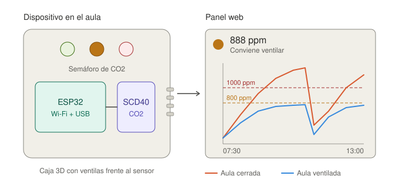
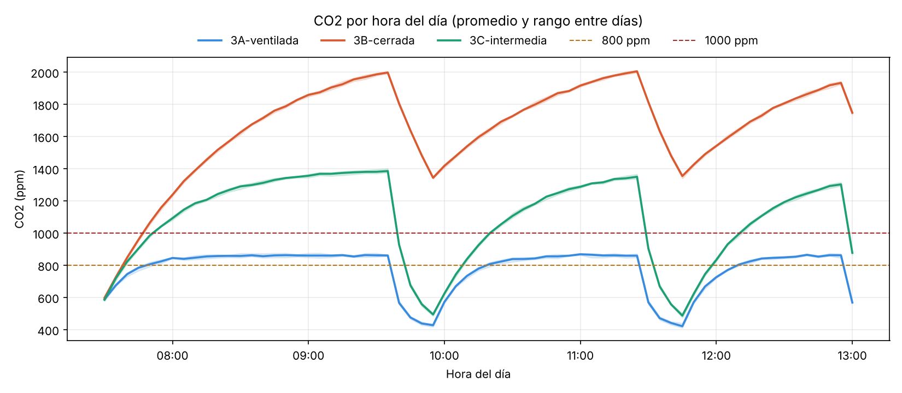
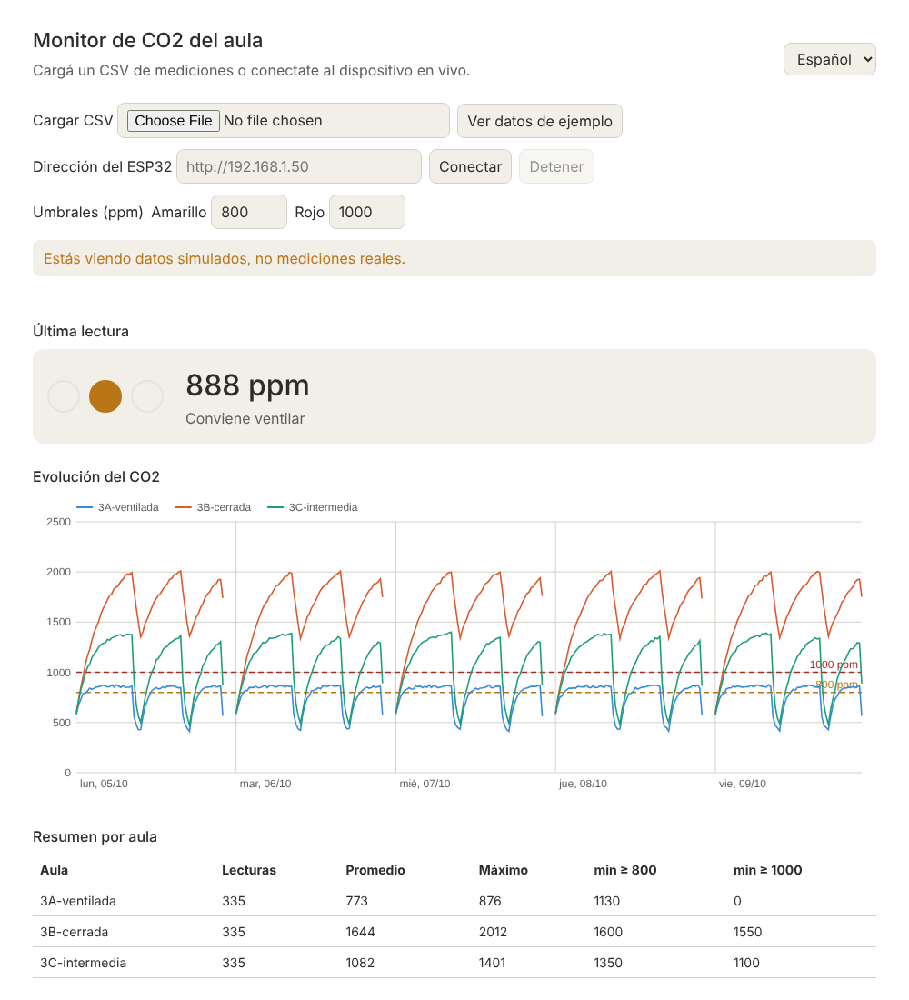

# Monitor de CO2 del aula

Dispositivo con ESP32 y un sensor de CO2 que enciende un semáforo (verde, amarillo, rojo) según la calidad del aire, un panel web bilingüe para ver los datos, scripts de Python para registrar y analizar mediciones de varias aulas, y una carcasa diseñada para impresión 3D. Incluye una guía docente y una rúbrica para usarlo como proyecto integrador en secundaria.



## Qué incluye

El repositorio tiene cuatro partes que se pueden usar por separado.

```
firmware/   programa del ESP32 (PlatformIO): lee el SCD40 y maneja el semáforo
panel/      panel web (HTML, CSS y JavaScript, sin dependencias), en español e inglés
software/   registrar.py, analizar.py y generar_ejemplo.py
caja/       caja.scad: base y tapa paramétricas en OpenSCAD
datos/      ejemplo.csv (datos simulados) y tus mediciones
docs/       cableado, lista de materiales, guía docente, rúbrica, registro de uso de IA
tests/      pruebas de Python, JavaScript y de las funciones del firmware
```

## Inicio rápido

Armá el circuito según [docs/cableado.md](docs/cableado.md): el SCD40 por I2C (3V3, GND, GPIO 21 y 22) y tres LEDs con resistencia en los GPIO 25, 26 y 27. Cargá el firmware con PlatformIO:

```bash
pio run -d firmware -t upload
pio device monitor -d firmware
```

En el monitor vas a ver líneas como `12000,845,22.4,48.1` (milisegundos, ppm de CO2, °C y % de humedad relativa). Con el dispositivo conectado por USB en la PC, registrá las lecturas indicando el aula:

```bash
pip install -r software/requirements.txt
python software/registrar.py --puerto COM3 --aula 3B        # en Linux: /dev/ttyUSB0
python software/analizar.py datos/lecturas.csv --salida grafico.png
```

Para probar todo sin hardware hay una semana de datos simulados de tres aulas. No son mediciones reales:

```bash
python software/analizar.py datos/ejemplo.csv --salida docs/grafico_ejemplo.png
```



`analizar.py` imprime un resumen por aula (promedio, máximo y minutos sobre cada umbral) y puede guardarlo con `--resumen resumen.csv`. Con `--modo serie` dibuja la línea de tiempo completa en lugar del perfil por hora.

## Panel web

El panel no necesita instalar nada. Para abrirlo con el botón de datos de ejemplo, servilo desde la raíz del repositorio:

```bash
python -m http.server 8000
```

Después abrí `http://localhost:8000/panel/`. Podés cargar tu propio CSV, ajustar los umbrales y cambiar el idioma. También podés conectarlo en vivo con el ESP32 si activás el Wi-Fi (ver la sección siguiente) e ingresás su dirección IP. Para eso el panel tiene que abrirse por `http://`, no por `https://`, porque el navegador bloquea las consultas a un dispositivo sin certificado.



## Wi-Fi opcional

En `firmware/src/config.h` poné `USAR_WIFI` en `1`, copiá `firmware/src/secrets.example.h` como `secrets.h` y completá tu red. El ESP32 responde en `http://<ip>/datos.json` con el CO2, la temperatura, la humedad y el estado. El archivo `secrets.h` está en `.gitignore`, así que tus credenciales no se suben al repositorio.

## La caja

Abrí `caja/caja.scad` en OpenSCAD, elegí `parte = "base"` o `"tapa"` y exportá a STL (F6 y luego F7). Las medidas externas son de unos 87 x 63 x 26,4 mm para la base más 3 mm de tapa. La tapa lleva tres orificios para los LEDs de 5 mm y las ventilas de la base quedan frente al sensor para que el aire del aula lo alcance. Se imprime sin soportes, con base y tapa apoyadas en la cama. Recomendación de partida: PETG o PLA, capa de 0,2 mm, 3 perímetros y 20 % de relleno. Se cierra con cuatro tornillos M3 autorroscantes. Los parámetros de la placa y del sensor están al inicio del archivo por si usás otros modelos.

## Uso en el aula

El proyecto está pensado como actividad integradora para secundaria, en espacios de tecnología, informática o robótica. Los estudiantes miden el CO2 de varias aulas durante una o dos semanas, analizan los datos y presentan a la dirección una propuesta de mejora de la ventilación basada en evidencia. Reúne electrónica y sensores, programación de microcontroladores, análisis de datos, diseño UX/UI, programación asistida con IA con verificación, diseño y fabricación 3D, y comunicación, con parte del trabajo en inglés.

La propuesta completa, con diez clases sugeridas, las competencias que trabaja, el protocolo de uso responsable de IA y las adaptaciones por nivel, está en [docs/guia_docente.md](docs/guia_docente.md). La evaluación se apoya en la [rúbrica](docs/rubrica.md), que describe cuatro niveles de desempeño por criterio, y en la [plantilla de registro de uso de IA](docs/registro_prompts_plantilla.md). Los umbrales de 800 y 1000 ppm son valores de referencia editables que el curso puede discutir y justificar con una fuente.

## Límites de las mediciones

El SCD40 es un sensor de CO2 de calidad adecuada para esta actividad, pero no es un instrumento de laboratorio, y su temperatura y humedad se sesgan por el calor de la propia placa. Los resultados sirven para comparar aulas y observar tendencias, y no para afirmar valores exactos ni para atribuir causas sin más datos. Ver [docs/cableado.md](docs/cableado.md).

## Pruebas

```bash
pip install pytest
pytest tests                       # Python
node --test tests/panel.test.js    # panel web
g++ -std=c++17 -o prueba_conversiones tests/test_conversiones.cpp && ./prueba_conversiones   # firmware (funciones puras)
```

## Licencia

MIT. Ver [LICENSE](LICENSE).
